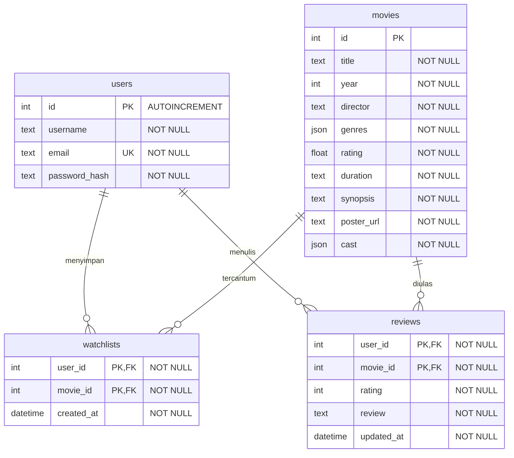

# FilmLog

FilmLog adalah REST API untuk menyimpan film ke watchlist, mencatat film yang sudah ditonton, dan memberi rating serta ulasan. Fitur rekomendasi memakai Google Gemini untuk memilih satu film dari katalog awal FilmLog.

Proyek ini dibuat oleh **Janu Pasha Shandy Putra** untuk penugasan GDGoC Backend Recruitment. Backend menggunakan Node.js, TypeScript, Express, Prisma, dan SQLite. Frontend bawaan menggunakan HTML, JavaScript, dan Tailwind CSS.

## Demo

- **Base URL API** — `https://filmlog-janupasha.onrender.com/api`
- [Health check](https://filmlog-janupasha.onrender.com/api/health)
- [Contoh detail film](https://filmlog-janupasha.onrender.com/api/movies/1)

Demo berjalan di Render Free dengan SQLite sementara. Render bisa tidur saat tidak digunakan, sehingga permintaan pertama bisa lebih lambat. Akun, watchlist, dan review demo dapat ter-reset saat instance berhenti atau saat deploy ulang. Skrip startup mengisi kembali katalog awal dari [data/movies.json](data/movies.json).

## Menjalankan secara lokal

Siapkan Node.js 22.23.2, npm, dan Python 3 untuk menyajikan frontend.

### Backend

```bash
git clone https://github.com/janupashasp/filmlog-janupasha.git
cd filmlog-janupasha/backend
npm ci --include=dev
```

Buat file `backend/.env`. 
```dotenv
DATABASE_URL=file:./dev.db
JWT_SECRET=ganti_dengan_hasil_openssl
# GEMINI_API_KEY=isi_dengan_api_key
# GEMINI_MODEL=isi_dengan_id_model
```

Dari folder `backend/`, jalankan:

```bash
npx prisma generate --config prisma7.config.ts
touch dev.db
npx prisma migrate deploy --config prisma7.config.ts
npm run seed
npm run dev
```

API berjalan di [http://localhost:8000/api/health](http://localhost:8000/api/health). `npm run typecheck` bisa dipakai untuk memeriksa tipe TypeScript.

### Frontend

Di terminal kedua, masuk ke **root repositori** `filmlog-janupasha/` lalu jalankan:

```bash
python3 -m http.server 3000 --bind 127.0.0.1 --directory frontend
```

Buka [http://localhost:3000/](http://localhost:3000/). Di menu **API** isi **API Base URL** dengan `http://localhost:8000/api` untuk backend lokal atau `https://filmlog-janupasha.onrender.com/api` untuk demo. Klik **Save & Reconnect**.

## Dokumentasi REST API

Untuk request dengan body JSON, kirim `Content-Type: application/json`. Endpoint bertanda **JWT** membutuhkan header `Authorization: Bearer <token>`. Token diperoleh dari endpoint login.

| Method dan endpoint | Akses | Input | Respons sukses |
| --- | --- | --- | --- |
| `GET /api/health` | Publik | — | `200` dengan pesan status backend |
| `POST /api/auth/register` | Publik | `username`, `email`, `password` | `201` dengan objek `user` |
| `POST /api/auth/login` | Publik | `email`, `password` | `200` dengan `token` dan `user` |
| `GET /api/movies` | Publik | Query opsional `search`, `genre`, `shuffle=true` | `200` dengan daftar film |
| `GET /api/movies/:id` | Publik | ID film pada URL | `200` dengan detail film |
| `POST /api/movies/recommend` | Publik | `prompt` | `200` dengan `movie_id` dan `reasoning` |
| `GET /api/watchlist` | JWT | — | `200` dengan daftar watchlist akun, termasuk detail film |
| `POST /api/watchlist` | JWT | `movieId` | `201` dengan entri watchlist baru |
| `DELETE /api/watchlist/:movieId` | JWT | ID film pada URL | `204` tanpa body |
| `GET /api/watched` | JWT | — | `200` dengan daftar review akun, termasuk detail film |
| `POST /api/watched` | JWT | `movieId`, `rating` (bilangan bulat 1–5), `review` | `201` dengan review yang dibuat atau diperbarui |

### Contoh request

```bash
API=https://filmlog-janupasha.onrender.com/api

curl -i "$API/movies/1"

curl -i "$API/movies/recommend" \
  -H 'Content-Type: application/json' \
  --data '{"prompt":"Rekomendasikan satu film misteri dengan alur non-linear."}'
```

Untuk contoh watchlist, daftar akun uji melalui frontend atau endpoint registrasi, lalu ambil nilai `token` dari respons login. Ganti `TOKEN_DARI_LOGIN` sebelum menjalankan request ini.

```bash
curl -i "$API/watchlist" \
  -H 'Authorization: Bearer TOKEN_DARI_LOGIN' \
  -H 'Content-Type: application/json' \
  --data '{"movieId":1}'
```

Respons error menggunakan format `{"message":"..."}`.

| Status | Contoh |
| --- | --- |
| `400 Bad Request` | JSON rusak, ID film tidak valid, atau rating di luar rentang |
| `401 Unauthorized` | Login gagal, token hilang, atau token tidak valid |
| `403 Forbidden` | Request watchlist menyertakan `userId` milik akun lain |
| `404 Not Found` | Film tidak ditemukan atau entri watchlist milik akun tidak ada |
| `409 Conflict` | Email atau entri watchlist duplikat, atau pelanggaran foreign key |
| `413 Content Too Large` | Body melebihi batas 32 KB |
| `502 Bad Gateway` | Panggilan Gemini gagal atau respons Gemini tidak valid |
| `503 Service Unavailable` | Konfigurasi Gemini belum tersedia atau katalog kandidat kosong |

## Arsitektur Database



Satu akun dan satu film masing-masing dapat terhubung ke banyak entri watchlist atau review. Setiap entri menunjuk ke tepat satu akun dan satu film. Pasangan `(user_id, movie_id)` menjadi primary key gabungan di masing-masing tabel, sehingga satu akun hanya punya satu entri watchlist dan satu review per film. Diagram menampilkan kolom utama. Skema lengkap ada di [schema.prisma](backend/prisma/schema.prisma).

## Keamanan dan Rekomendasi

- [auth.ts](backend/src/auth.ts) menyimpan hash password dengan bcrypt dan memverifikasi JWT. [activity.ts](backend/src/activity.ts) memakai ID akun dari token untuk membatasi akses ke watchlist dan review.
- [http.ts](backend/src/http.ts) memakai Zod untuk memvalidasi input. [server.ts](backend/src/server.ts) memusatkan respons error dan memetakan konflik Prisma ke status `409`.
- [recommend.ts](backend/src/recommend.ts) mengambil kandidat dari database berdasarkan ID pada katalog awal. Backend mengirim ID, judul, genre, dan sinopsis sebagai konteks ke Gemini. Instruksi sistem meminta satu pilihan dari kandidat dan alasan singkat dalam bahasa Indonesia. Setelah menerima hasil, backend memvalidasi struktur JSON dan mencocokkan `movie_id` dengan daftar kandidat sebelum mengembalikan respons.
